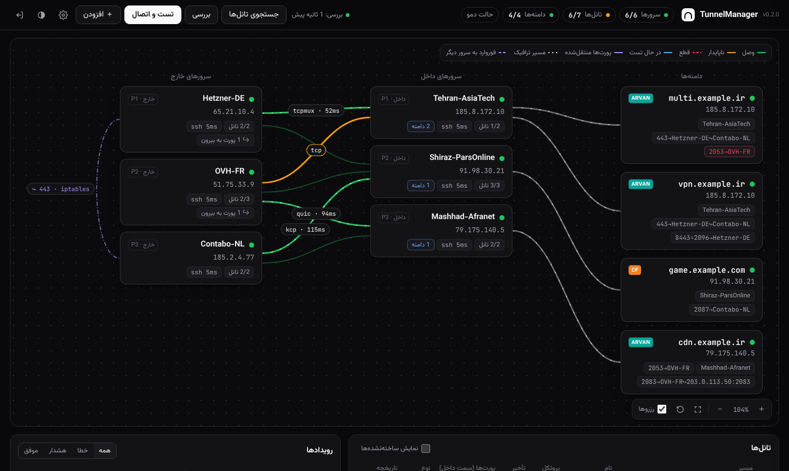
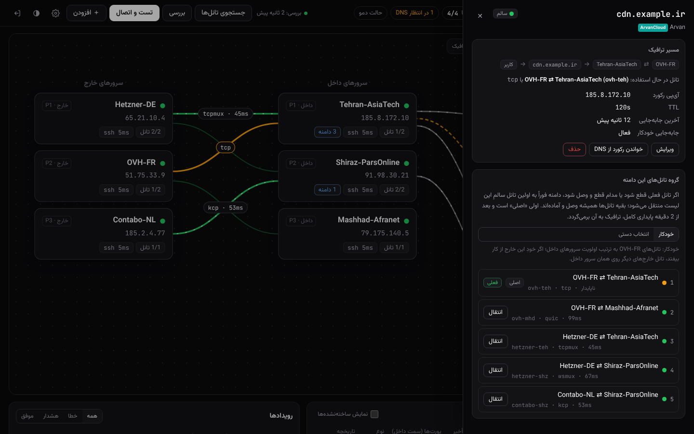
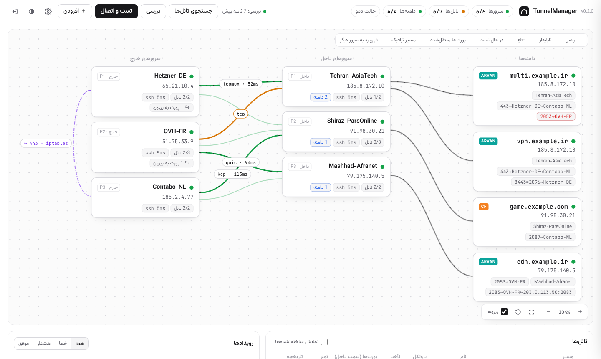

<div dir="rtl">

# TunnelManager

پنل مدیریت و مانیتورینگ تانل‌های **[BackPack](https://github.com/AminMGMT/BackPack)** بین سرورهای داخل و خارج، با جابه‌جایی خودکار مسیر، تغییر رکورد DNS در **ArvanCloud** و **Cloudflare**، و گزارش همه اتفاق‌ها در **تلگرام**.



## چه کار می‌کند

- **میز کار گرافیکی**: سرورهای خارج سمت چپ، سرورهای داخل وسط، دامنه‌ها سمت راست، روی یک صفحه نقطه‌چین (سیاه یا سفید).
  - با چرخ ماوس یا دو انگشت زوم کنید و با کشیدن صفحه جابه‌جا شوید.
  - هر سرور یا دامنه را می‌شود با ماوس جابه‌جا کرد و چیدمان ذخیره می‌شود.
  - هر خط یک تانل است. رنگ خط وضعیتش را نشان می‌دهد و روی آن پروتکل و تأخیر نوشته شده.
  - مسیرهایی که الان ترافیک می‌برند جریان متحرک دارند. خط زرد خط‌چین یعنی رکورد DNS تغییر کرده و هنوز به کاربران نرسیده.
- **حالت تاریک و روشن**: به‌طور پیش‌فرض از تنظیم سیستم پیروی می‌کند و با یک دکمه عوض می‌شود.
- **پیدا کردن خودکار تانل‌های موجود**: کافی است سرورها را (فقط آی‌پی و SSH) اضافه کنید.
  - پنل `/etc/backpack` همه سرورها را می‌خواند و سمت داخل و خارج هر تانل را با پورت و توکن جفت می‌کند.
  - تانل‌هایی که از قبل فعال‌اند با اسم، پروتکل، پورت‌ها و بقیه تنظیماتشان اضافه می‌شوند.
  - این جستجو هر ۱۰ دقیقه تکرار می‌شود.
- **پورت‌های فورواردی سمت سرور داخل**: همان‌طور که در BackPack است، پورت‌ها روی کانفیگ داخل هر تانل تعریف می‌شوند و خارج کاری با آن‌ها ندارد.
- **چند تانل بین یک جفت سرور**: مثلاً یکی با tcpmux و یک رزرو با wsmux.
- **گروه تانل برای هر دامنه**: انتخاب می‌کنید کدام تانل‌ها و به چه ترتیبی. در قطعی، جابه‌جایی فقط بین همین تانل‌ها انجام می‌شود.
- **تغییر پروتکل با یک کلیک**: مثلاً از TCP Mux به WS Mux. می‌شود پروتکل را قفل کرد یا مشخص کرد بازسازی خودکار کدام پروتکل‌ها را امتحان کند.
- **ساخت تانل جدید**: همه پروتکل‌ها تست می‌شوند و سریع‌ترین مستقر می‌شود. اگر BackPack روی سرور نصب نباشد، پنل خودش نصبش می‌کند.
- **تلگرام**: هر کاری که پنل انجام می‌دهد گزارش می‌شود. دستورهای `/status`، `/links`، `/domains`، `/check` و `/scan` هم در ربات کار می‌کنند.

## منطق جابه‌جایی

همه تانل‌های گروه یک دامنه همیشه وصل و آماده نگه داشته می‌شوند. رکورد A دامنه به سرور داخلِ تانلی اشاره می‌کند که الان استفاده می‌شود.

| اتفاق | واکنش پنل | پیام تلگرام |
|---|---|---|
| سرور داخل اصلی به مشکل خورد، یا تانلش قطع شد | رکورد دامنه **فوراً** در آروان یا کلادفلر به سرور داخل بعدی گروه تغییر می‌کند، که تانلش از قبل وصل است. | «سرور اول به مشکل خورد» و «رکورد تغییر کرد» |
| تانل مدام قطع و وصل می‌شود (پیش‌فرض: ۳ قطعی در ۱۰ دقیقه)، حتی اگر هیچ‌وقت کامل قطع نماند | مثل قطعی کامل با آن رفتار می‌شود و دامنه منتقل می‌شود. | «مدام قطع و وصل می‌شود» |
| رکورد تغییر کرده | پنل مدام DNSهای عمومی (1.1.1.1 و 8.8.8.8) را چک می‌کند تا آی‌پی جدید را نشان بدهند. | «بعد از X دقیقه، سرور دوم پشت دامنه قرار گرفت و ترافیک از تانل Y می‌گذرد» |
| تانل قطع شده ولی هر دو سرورش در دسترس‌اند | در پس‌زمینه با پروتکل‌های دیگر دوباره ساخته می‌شود. | «دوباره برقرار شد و وارد مدار شد» یا «بازسازی ناموفق بود» |
| سرور اول درست شد | تا **۱۰ دقیقه پایداری کامل** صبر می‌شود. یک قطعی در این مدت شمارش را از اول شروع می‌کند. بعد ترافیک برمی‌گردد. | «دوباره در دسترس است» و بعد «برگشت به سرور اصلی» |
| خودِ سرور خارج خاموش شد | به‌جای عوض کردن رکورد، پورت‌ها روی همان سرور داخل به تانل یک خارج دیگر منتقل می‌شوند. ترافیک به خارج جدید می‌رود و DNS دست نمی‌خورد. | «پورت‌ها منتقل شد» |
| سرور دوم هم به مشکل خورد | دامنه به تانل سالم بعدی گروه می‌رود. اگر هیچ تانل سالمی نماند، گزارش می‌شود و پنل تانل‌ها را تعمیر می‌کند. | «به مشکل خورد» و «هیچ تانل سالمی نیست» |

جابه‌جایی‌ها بی‌دلیل اتفاق نمی‌افتند:

- یک یا دو خطای گذرا باعث جابه‌جایی نمی‌شود. «قطع» یعنی چند خطای پشت‌سرهم، که قابل تنظیم است.
- پنل هیچ‌وقت ترافیک را از تانلی که کار می‌کند جابه‌جا نمی‌کند.
- برگشت به اصلی فقط بعد از پایداری کامل انجام می‌شود.



> **سلامت چطور سنجیده می‌شود؟** هر تانلی که پنل می‌سازد یا بازنویسی می‌کند، روی سرور داخل یک پورت پروب فقط-لوکال دارد (`127.0.0.1:61000 → 127.0.0.1:22` سمت خارج). پنل روی سرور داخل به آن وصل می‌شود و بنر SSH سرور خارج را از داخل تانل می‌خواند. این یعنی کل مسیر واقعاً کار می‌کند، نه فقط اینکه پروسه بالاست.
>
> تانل‌های موجود تا وقتی پنل کانفیگشان را بازنویسی نکرده پروب ندارند. سلامت آن‌ها از گزارش خود BackPack و اتصال‌های برقرار روی پورت تانل سنجیده می‌شود.

## نصب

پنل را روی سروری **خارج از ایران** نصب کنید (یکی از سرورهای خارج یا یک سرور جدا). پنل باید به این‌ها دسترسی داشته باشد: API تلگرام، API آروان و کلادفلر، گیت‌هاب (برای دانلود BackPack) و SSH همه سرورها.

```bash
git clone https://github.com/MHBehzadian/TunnelManager.git
cd TunnelManager
sudo bash deploy/install.sh
```

اسکریپت آدرس پنل و یک رمز تصادفی برای کاربر `admin` چاپ می‌کند. برای تغییر رمز:

```bash
/opt/tunnelmanager/venv/bin/python -m tunnelmanager --data /var/lib/tunnelmanager passwd
```

برای HTTPS، مسیر گواهی را در `/etc/default/tunnelmanager` تنظیم کنید (`TM_SSL_CERT` و `TM_SSL_KEY`) یا پنل را پشت nginx یا caddy بگذارید.

### اجرای دستی یا دمو

```bash
apt install -y python3-venv
python3 -m venv venv
./venv/bin/pip install -r requirements.txt
./venv/bin/python -m tunnelmanager demo --host 0.0.0.0 --port 8080     # دمو با شبکه شبیه‌سازی‌شده
./venv/bin/python -m tunnelmanager serve --host 0.0.0.0 --port 8080    # پنل واقعی
```

بعد در مرورگر `http://IP-سرور:8080` را باز کنید. در اولین ورود، نام کاربری و رمز را خودتان تعیین می‌کنید.

حالت **دمو** به هیچ سروری وصل نمی‌شود. چند سرور با تانل‌های «از قبل موجود» می‌سازد و هر یک دقیقه چیزی را خراب می‌کند، تا جابه‌جایی‌ها را زنده ببینید:

- فیلتر شدن یک پروتکل
- قطع و وصل مداوم یک مسیر
- خاموش شدن یک سرور داخل یا خارج



## راه‌اندازی

1. **سرورهای خارج و داخل** را اضافه کنید: آی‌پی و اطلاعات SSH (رمز یا کلید). تانل‌هایی که از قبل روی آن‌ها فعال است خودکار پیدا می‌شوند.
2. برای جفت‌هایی که تانل ندارند **«تست و اتصال»** را بزنید، یا از منوی «افزودن» یک **تانل جدید** بسازید. پورت‌های فورواردی را روی هر تانل، سمت سرور داخل، تعریف کنید:
   - `443`: پورت 443 داخل به 127.0.0.1:443 روی خارج
   - `8443=2096`: پورت 8443 داخل به 2096 خارج
   - `2053-2060`: یک بازه
3. در تنظیمات **حساب DNS** اضافه کنید:
   - آروان: API Key
   - کلادفلر: API Token با دسترسی Zone.DNS:Edit
4. **دامنه** اضافه کنید و بگویید سرویسش روی کدام خارج است. اگر رکورد الان به یکی از سرورهای داخل اشاره کند، همان نقطه شروع می‌شود.
5. در پنل دامنه، **گروه تانل‌ها** را تنظیم کنید:
   - **خودکار**: همه تانل‌های آن خارج، به ترتیب اولویت سرورهای داخل.
   - **دستی**: انتخاب کنید کدام تانل‌ها و به چه ترتیبی. اولی «اصلی» است.
6. در تنظیمات، **توکن ربات تلگرام** و Chat ID را وارد کنید. اگر Chat ID را نمی‌دانید، به ربات `/start` بدهید.

## جزئیات فنی

- تانل‌هایی که پنل می‌سازد `tm-<id>` نام دارند. تانل‌های موجود اسم خودشان را نگه می‌دارند. ساختار فایل‌ها همان ساختار خود BackPack است:
  - کانفیگ: `/etc/backpack/<name>.toml`
  - سرویس: `backpack-<name>.service`
- وقتی پنل کانفیگ یک تانل موجود را بازنویسی می‌کند (تغییر پروتکل، پورت یا تعمیر)، فقط پروتکل، توکن، پورت‌ها و پورت پروب عوض می‌شوند. بقیه تنظیمات تانل دست نمی‌خورد، از جمله `mux_*`، `bind_addr` اختصاصی و هاست `remote_addr`.
- «فراموش کردن» یک تانل موجود فقط آن را از پنل حذف می‌کند. تانل روی سرور می‌ماند.
- `udp` در لیست تست نیست، چون فقط UDP منتقل می‌کند.
- همه اطلاعات در `/var/lib/tunnelmanager/state.json` (دسترسی 600) ذخیره می‌شود، از جمله رمزهای SSH و توکن‌ها. از این پوشه نسخه پشتیبان بگیرید.

## توسعه

```bash
pip install -r requirements.txt pytest pytest-asyncio
python -m pytest
# تست اسکریپت‌های سلامت روی موتور واقعی BackPack:
TM_BACKPACK_BIN=/path/to/backpack python -m pytest tests/test_backpack.py
```

</div>

---

### English summary

TunnelManager is a web panel for [BackPack](https://github.com/AminMGMT/BackPack) reverse tunnels.

- **Canvas:** a zoomable, pannable dotted workbench in black or white, with draggable servers.
- **Adoption:** it adopts tunnels that are already running on your servers.
- **Failover groups:** each domain has an ordered failover group of hot-standby tunnels.
- **Failover:** when the active tunnel breaks or flaps, the domain moves immediately. This means an A-record change on ArvanCloud or Cloudflare, or a same-server port handover when a kharej dies. The panel then reports when public resolvers see the new IP.
- **Failback:** traffic returns to the primary only after 10 minutes of uninterrupted health.
- **Telegram:** every step is reported.
