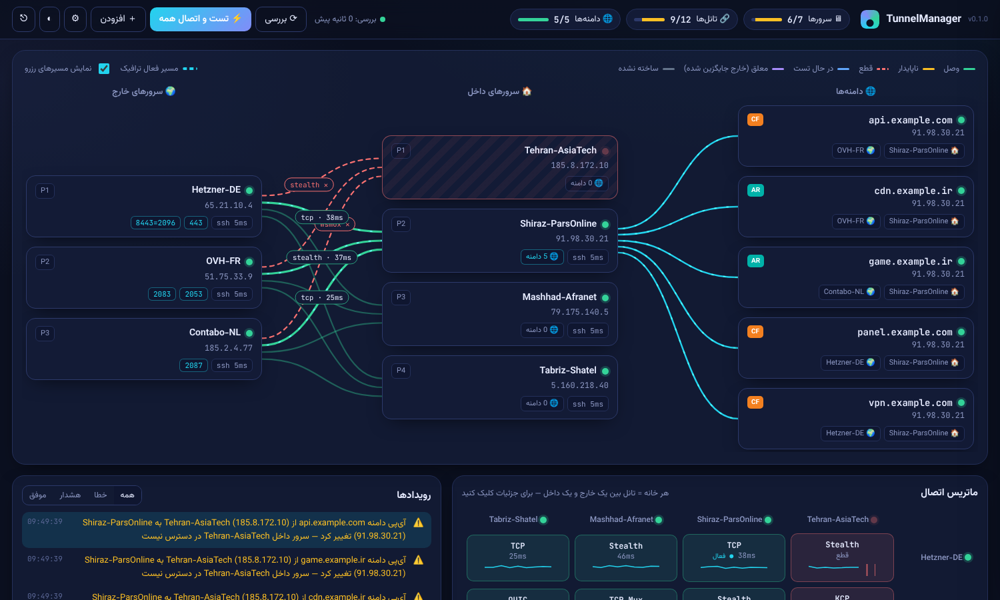

<div dir="rtl">

# TunnelManager

پنل مدیریت و مانیتورینگ تانل‌های **[BackPack](https://github.com/AminMGMT/BackPack)** بین سرورهای داخل و خارج، با جابه‌جایی خودکار مسیر و تغییر رکورد DNS در **Cloudflare** و **ArvanCloud**، و اطلاع‌رسانی کامل در **تلگرام**.



*سرور داخل Tehran از دسترس خارج شده؛ تانل‌هایش قرمز شده‌اند و همه دامنه‌ها خودکار به Shiraz منتقل شده‌اند.*

## چه کار می‌کند

- **نمای گرافیکی زنده**: سرورهای خارج سمت چپ، سرورهای داخل وسط، دامنه‌ها سمت راست. هر خط یک تانل است. رنگ خط وضعیت را نشان می‌دهد و روی خط، پروتکل و تأخیر نوشته شده. مسیرهایی که الان ترافیک دامنه‌ها را می‌برند با جریان متحرک مشخص شده‌اند. با بردن ماوس روی هر سرور یا دامنه، کل مسیرش روشن می‌شود.
- **ماتریس اتصال**: همه جفت‌های خارج × داخل با پروتکل، تأخیر و نمودار کوچک تاریخچه.
- **تست و اتصال خودکار**: از همه خارج‌ها به همه داخل‌ها، همه پروتکل‌ها (`tcpmux`، `wsmux`، `tcp`، `ws`، `stealth`، `kcp`، `quic`، …) تست می‌شوند و سریع‌ترینِ سالم مستقر می‌شود.
- **تغییر دستی پروتکل**: روی هر تانل کلیک کنید و مثلا از TCP Mux به WS Mux ببرید. می‌توانید پروتکل را قفل کنید تا مانیتور خودش عوضش نکند.
- **مانیتورینگ مداوم و خوددرمانی**: جزئیات در بخش بعد.
- **تلگرام**: همه رویدادها ارسال می‌شوند. دستورهای `/status`، `/links`، `/domains` و `/check` هم در ربات کار می‌کنند.

## منطق جابه‌جایی

هر دامنه به **یک سرور داخل** اشاره می‌کند (رکورد A) و سرویسش روی **یک سرور خارج** است. پنل هر چند ثانیه (پیش‌فرض ۳۰) همه مسیرها را end-to-end تست می‌کند.

| اتفاق | واکنش پنل |
|---|---|
| تانل بین داخلِ فعلی و خارج قطع شد، ولی هر دو سرور در دسترس‌اند | پروتکل‌های دیگر را روی همان جفت امتحان می‌کند (سریع‌ترین اول). اگر یکی جواب داد، به تلگرام خبر می‌دهد و تمام. |
| هیچ پروتکلی جواب نداد | به تلگرام خبر می‌دهد، رکورد A دامنه را به یک **سرور داخل دیگر** که تانل سالمی به همان خارج دارد تغییر می‌دهد و دوباره خبر می‌دهد. |
| خودِ سرور داخل از دسترس خارج شد | دامنه‌هایش مستقیم به داخل سالم دیگر منتقل می‌شوند. |
| **سرور خارج کامل از کار افتاد** (SSH جواب نمی‌دهد و هیچ تانلش وصل نیست) | به‌جای جابه‌جایی داخل، **خارج عوض می‌شود**: پورت‌های خارجِ خراب روی تانل‌های یک خارج سالم باز می‌شوند. دامنه‌ها روی همان داخل می‌مانند و ترافیک به خارج جدید می‌رود. |
| خارج خراب برگشت | اگر «برگشت خودکار» روشن باشد، پورت‌هایش پس داده می‌شود و تانل‌هایش دوباره ساخته می‌شوند. |

اقدام فقط بعد از چند خطای پشت‌سرهم انجام می‌شود (پیش‌فرض ۳). این آستانه در تنظیمات قابل تغییر است و جلوی جابه‌جایی با هر قطعی لحظه‌ای را می‌گیرد.

> **چطور سلامت تست می‌شود؟** روی سرور داخل، هر تانل علاوه بر پورت‌های شما یک پورت پروب فقط-لوکال دارد (`127.0.0.1:61000 → 127.0.0.1:22` سمت خارج). پنل از طریق SSH روی سرور داخل به آن وصل می‌شود و بنر `SSH-` سرور خارج را می‌خواند. این یعنی کل مسیر واقعا کار می‌کند، نه فقط اینکه پروسه بالاست.

## نصب

پنل را روی سروری **خارج از ایران** نصب کنید (یکی از سرورهای خارج یا یک سرور جدا). پنل باید به این‌ها دسترسی داشته باشد: API تلگرام، API کلادفلر و آروان، گیت‌هاب (برای دانلود BackPack) و SSH همه سرورها.

```bash
git clone https://github.com/MHBehzadian/TunnelManager.git
cd TunnelManager
sudo bash deploy/install.sh
```

اسکریپت آدرس پنل و یک رمز تصادفی برای کاربر `admin` چاپ می‌کند. برای تغییر رمز:

```bash
/opt/tunnelmanager/venv/bin/python -m tunnelmanager --data /var/lib/tunnelmanager passwd
```

برای HTTPS، مسیر گواهی را در `/etc/default/tunnelmanager` تنظیم کنید (`TM_SSL_CERT` و `TM_SSL_KEY`) یا پنل را پشت nginx یا caddy بگذارید.

### اجرای دستی یا دمو

```bash
pip install -r requirements.txt
python -m tunnelmanager serve --port 8080      # پنل واقعی
python -m tunnelmanager demo  --port 8080      # دمو با شبکه شبیه‌سازی‌شده و خرابی‌های تصادفی
```

حالت **دمو** به هیچ سروری وصل نمی‌شود. چند سرور و دامنه ساختگی می‌سازد و هر یک دقیقه چیزی را خراب می‌کند (فیلتر شدن یک پروتکل، خاموش شدن یک سرور داخل یا خارج) تا رفتار پنل را ببینید.

## راه‌اندازی قدم‌به‌قدم

1. **سرورهای خارج** را اضافه کنید: آی‌پی، اطلاعات SSH (رمز یا کلید)، و **پورت‌های فورواردی** با سینتکس BackPack:
   - `443` یعنی پورت 443 داخل به `127.0.0.1:443` روی همین خارج
   - `8443=2096` یعنی پورت 8443 داخل به 2096 خارج
   - `2053-2060` برای یک بازه
   - اگر چند خارج دارید، پورت‌هایشان نباید تکراری باشد، چون همه روی سرورهای داخل باز می‌شوند.
2. **سرورهای داخل** را اضافه کنید.
3. در تنظیمات، **حساب DNS** اضافه کنید:
   - کلادفلر: API Token با دسترسی Zone.DNS:Edit
   - آروان: API Key
4. **دامنه‌ها** را اضافه کنید و مشخص کنید سرویس هر دامنه روی کدام خارج است. اگر رکورد فعلی به یکی از داخل‌ها اشاره کند، همان نقطه شروع می‌شود.
5. دکمه **«تست و اتصال همه»** را بزنید. اگر BackPack روی سرورها نصب نباشد، پنل آن را از گیت‌هاب دانلود می‌کند، چک‌سام را بررسی می‌کند و از طریق SSH روی سرور می‌گذارد، حتی روی سرورهای داخلی که به گیت‌هاب دسترسی ندارند.
6. در تنظیمات، **توکن ربات تلگرام** و Chat ID را وارد کنید. اگر Chat ID را نمی‌دانید، به ربات `/start` بدهید.

## جزئیات فنی

- هر تانل یک سرویس BackPack با نام `tm-<id>` است و با ساختار خود BackPack ساخته می‌شود:
  - کانفیگ: `/etc/backpack/tm-<id>.toml`
  - سرویس: `backpack-tm-<id>.service`
  
  به همین خاطر تانل‌ها در CLI و پنل خود BackPack هم دیده می‌شوند. تانل‌هایی که خودتان دستی ساخته‌اید دست نمی‌خورند.
- پورت تانل روی سرورهای داخل از 3080 شروع می‌شود و برای هر تانل جدا است. اگر ufw فعال باشد، پورت‌ها خودکار باز می‌شوند.
- `udp` در لیست تست نیست، چون فقط UDP منتقل می‌کند. `wss` و `wssmux` با گواهی self-signed کار می‌کنند و در تنظیمات قابل فعال شدن‌اند.
- همه اطلاعات در `/var/lib/tunnelmanager/state.json` (دسترسی 600) ذخیره می‌شود و شامل رمزهای SSH و توکن‌هاست. از این پوشه نسخه پشتیبان بگیرید.
- کلید میزبان SSH سرورها بررسی نمی‌شود، چون سرورها با آی‌پی در خود پنل تعریف می‌شوند. پنل را فقط در شبکه‌ای که به آن اعتماد دارید اجرا کنید.

## توسعه

```bash
pip install -r requirements.txt pytest pytest-asyncio
python -m pytest
# تست اسکریپت‌های سلامت روی موتور واقعی BackPack (لوکال):
TM_BACKPACK_BIN=/path/to/backpack python -m pytest tests/test_backpack.py
```

</div>

---

### English summary

TunnelManager is a web panel for [BackPack](https://github.com/AminMGMT/BackPack) reverse tunnels. It does four things:

- It shows every kharej server, Iran server and domain as a live graph.
- It tests every transport on every kharej × Iran pair and deploys the fastest one.
- It probes each tunnel end to end and heals failures automatically:
  1. If a tunnel breaks, it tries other transports on the same pair.
  2. If none work, it moves the domain's A record (Cloudflare or ArvanCloud) to another Iran server.
  3. If a kharej server dies, another kharej takes over its ports.
- It reports every event to Telegram.

`python -m tunnelmanager demo` runs it against a simulated network with random outages.
