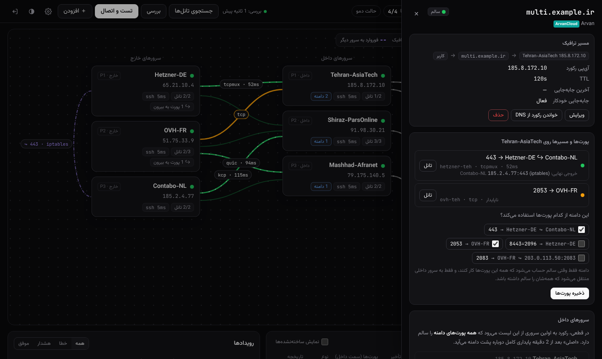
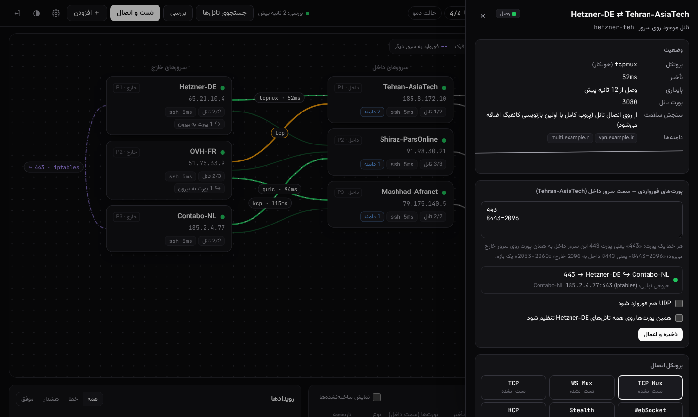
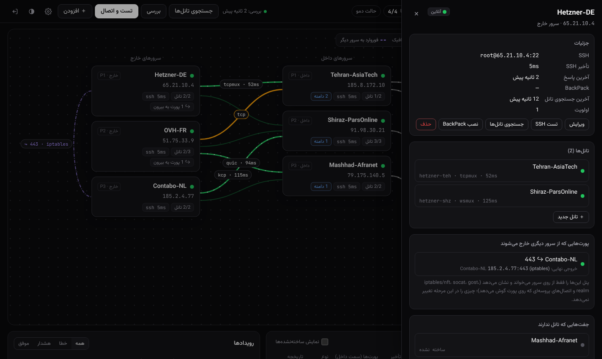
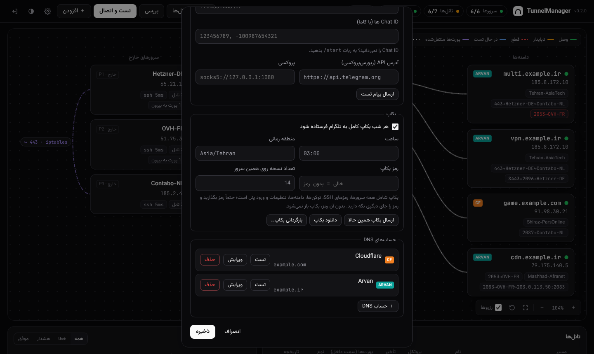

<div dir="rtl">

# TunnelManager

پنل مدیریت و مانیتورینگ تانل‌های **[BackPack](https://github.com/AminMGMT/BackPack)** بین سرورهای ایران و خارج. پنل قطعی‌ها را تشخیص می‌دهد، رکورد دامنه را در **ArvanCloud** یا **Cloudflare** به سرور سالم می‌برد و همه‌چیز را در **تلگرام** گزارش می‌کند.


## فهرست

- [امکانات](#امکانات)
- [نصب](#نصب)
- [پنل روی دامنه با HTTPS](#پنل-روی-دامنه-با-https)
- [شروع کار روی سرورهای لایو](#شروع-کار-روی-سرورهای-لایو)
- [کلید API آروان و کلادفلر](#کلید-api-آروان-و-کلادفلر)
- [منطق جابه‌جایی](#منطق-جابهجایی)
- [خروجی نهایی پورت‌ها](#خروجی-نهایی-پورتها)
- [بکاپ و بازگردانی](#بکاپ-و-بازگردانی)
- [ربات تلگرام](#ربات-تلگرام)
- [به‌روزرسانی](#بهروزرسانی)
- [جزئیات فنی](#جزئیات-فنی)

## امکانات

- **میز کار گرافیکی:** سرورهای خارج چپ، داخل وسط و دامنه‌ها راست. زوم و جابه‌جایی آزاد است، چیدمان ذخیره می‌شود و حالت تاریک و روشن دارد. رنگ هر خط وضعیت تانل است و پروتکل و تأخیر روی آن نوشته می‌شود.
- **پیدا کردن تانل‌های موجود:** سرورها را با آی‌پی و SSH اضافه کنید. پنل `/etc/backpack` را می‌خواند و تانل‌های فعال را با همان اسم، پروتکل و پورت‌ها اضافه می‌کند.
- **دامنه = سرور داخل + پورت‌ها:** هر پورت دامنه می‌تواند از تانل جدا به خارج متفاوتی برود. دامنه فقط وقتی سالم است که همه پورت‌هایش سالم باشند.
- **جابه‌جایی خودکار:** در قطعی یا ناپایداری، اول تانل دیگری روی همان سرور داخل امتحان می‌شود. بعد رکورد به سرور داخلی می‌رود که همه پورت‌ها را سالم دارد. بعد از ۱۰ دقیقه پایداری، ترافیک به سرور اصلی برمی‌گردد.
- **تغییر پروتکل با یک کلیک:** مثلاً tcpmux به wsmux. همه پروتکل‌ها تست می‌شوند و نتیجه و تأخیرشان کنار هم دیده می‌شود.
- **خروجی نهایی:** اگر پورتی از خارج به سرور دیگری فوروارد شود (iptables، socat، gost، رله و…)، در پنل دیده می‌شود.
- **حالت نظارت:** روشن است تا وقتی خودتان خاموشش کنید. در این حالت پنل فقط می‌بیند و گزارش می‌دهد.
- **بکاپ شبانه:** ساعت ۳ بامداد، رمزدار، به تلگرام فرستاده می‌شود. بازگردانی از داخل پنل یا خط فرمان انجام می‌شود.

| مسیر پورت‌های یک دامنه | تانل و پروتکل‌ها |
|---|---|
|  |  |

## نصب

پنل را روی یک سرور **خارج از ایران** نصب کنید، یکی از سرورهای خارج یا یک سرور جدا. پنل باید به API تلگرام، آروان و کلادفلر، گیت‌هاب و SSH همه سرورها دسترسی داشته باشد. اوبونتو ۲۲.۰۴ به بالا، با پایتون ۳.۱۰ به بالا.

```bash
git clone https://github.com/MHBehzadian/TunnelManager.git
cd TunnelManager
sudo bash deploy/install.sh
```

اسکریپت آدرس پنل و یک رمز تصادفی برای کاربر `admin` را چاپ می‌کند. پورت پیش‌فرض 8080 است. اگر پورت اشغال باشد، اسکریپت قبل از هر تغییری متوقف می‌شود. برای انتخاب پورت دیگر:

```bash
sudo TM_PORT=9090 bash deploy/install.sh
```

تغییر رمز:

```bash
/opt/tunnelmanager/venv/bin/python -m tunnelmanager --data /var/lib/tunnelmanager passwd
```

> نصب روی سروری که خودش BackPack دارد مشکلی ندارد. پنل سرویس جدا با سهم محدود CPU و RAM است و در مسیر ترافیک نیست. همان سرور را هم می‌شود در پنل به‌عنوان سرور خارج اضافه کرد.

## پنل روی دامنه با HTTPS

1. یک رکورد A بسازید که به آی‌پی سرور پنل اشاره کند، مثلاً `panel.example.com`. **پروکسی/ابر را برای این رکورد خاموش کنید.**
2. در فایروال سرور (و پنل دیتاسنتر) پورت‌های 80 و 443 را باز کنید.
3. اجرا کنید:

```bash
cd ~/TunnelManager
sudo bash deploy/https.sh panel.example.com you@example.com
```

اسکریپت این کارها را می‌کند:
- چک می‌کند پورت 443 و 80 آزاد باشند و دامنه واقعاً به همین سرور اشاره کند. اگر نه، **بدون هیچ تغییری** متوقف می‌شود و می‌گوید چه چیزی مانع است.
- از Let's Encrypt گواهی رایگان می‌گیرد. پورت 80 فقط چند ثانیه موقع صدور و تمدید استفاده می‌شود.
- پنل را روی 443 با HTTPS بالا می‌آورد و تمدید خودکار گواهی را تنظیم می‌کند.
- اگر پنل روی 443 بالا نیاید، تنظیمات قبلی را برمی‌گرداند.

## شروع کار روی سرورهای لایو

پنل در مسیر ترافیک نیست. ترافیک کاربران مستقیم از تانل‌های BackPack می‌گذرد. اگر پنل خاموش یا خراب شود، تانل‌ها مثل قبل کار می‌کنند.

1. **سرورها را اضافه کنید:** آی‌پی و SSH. تانل‌های فعال خودکار پیدا می‌شوند. فقط تانل‌هایی اضافه می‌شوند که سرویسشان در حال اجراست.
2. **حساب DNS اضافه کنید** (تنظیمات ← حساب‌های DNS) و دکمه «تست» را بزنید.
3. **دامنه‌ها را اضافه کنید.** پنل رکورد فعلی را می‌خواند و همان سرور داخل را «اصلی» می‌گیرد. رکورد دست نمی‌خورد.
4. در پنل هر دامنه، **پورت‌هایی را که دامنه استفاده می‌کند تیک بزنید.**
5. **چند روز در حالت نظارت بمانید.** پنل در تلگرام می‌گوید «اگر فعال بود چه می‌کرد». وقتی به پیشنهادها اعتماد کردید، حالت نظارت را از تنظیمات خاموش کنید.

محافظ‌هایی که همیشه فعال‌اند:
- اولین بازنویسی کانفیگ یک تانل موجود، نسخه اصلی را در `/etc/backpack/<name>.toml.tm-orig` نگه می‌دارد.
- روی پورتی که در حال استفاده است تانل ساخته نمی‌شود.
- «تست و اتصال» فقط تانل‌های ساخته‌نشده یا کاملاً قطع را می‌سازد و به تانل سالم یا ناپایدار دست نمی‌زند.
- جابه‌جایی فقط با دلیل انجام می‌شود: چند خطای پشت‌سرهم، نه یک خطای گذرا.

## کلید API آروان و کلادفلر

**Cloudflare:** پروفایل ← API Tokens ← Create Token ← قالب **Edit zone DNS**. در Zone Resources دامنه‌ها (یا All zones) را انتخاب کنید و توکن را در پنل وارد کنید.

**ArvanCloud:** دسترسی در آروان روی **منبع** داده می‌شود، نه روی خود کاربر:
1. پروفایل ← IAM ← فهرست ماشین یوزرها: یک ماشین یوزر بسازید. از منوی «کلیدهای دسترسی» یک کلید بگیرید.
2. IAM ← **مدیریت منابع و دسترسی‌ها**: دامنه را از بخش CDN انتخاب کنید. یک قانون دسترسی با نقشی که DNS را **می‌خواند و می‌نویسد** بسازید و ماشین یوزر را عضوش کنید.
3. در پنل، Zone را دامنه اصلی بگذارید (مثل `example.com`، نه `panel.example.com`).

> خطای `HTTP 403: Your access to this section is restricted` یعنی مرحله ۲ انجام نشده، یا حساب آروان به خاطر بدهی محدود شده است. پنل هر ۵ دقیقه دوباره امتحان می‌کند و تا وقتی رکورد خوانده نشود، به آن دست نمی‌زند.

## منطق جابه‌جایی

همه تانل‌ها همیشه وصل و آماده‌اند. رکورد A دامنه به سرور داخلی اشاره می‌کند که الان استفاده می‌شود.

| اتفاق | واکنش پنل |
|---|---|
| تانل یکی از پورت‌ها قطع شد ولی سرور داخل سالم است | همان پورت روی همان سرور داخل به تانل دیگری منتقل می‌شود (مثلاً یک خارج دیگر). DNS دست نمی‌خورد. |
| سرور داخل به مشکل خورد، یا مدام قطع و وصل می‌شود (پیش‌فرض: ۳ قطعی در ۱۰ دقیقه) | رکورد به اولین سرور داخلی می‌رود که **همه پورت‌های دامنه** را سالم دارد. |
| رکورد عوض شد | پنل DNSهای عمومی را چک می‌کند و می‌گوید بعد از چند دقیقه سرور جدید پشت دامنه قرار گرفت. |
| تانل قطع است ولی هر دو سرورش سالم‌اند | تانل با پروتکل‌های دیگر دوباره ساخته می‌شود. این کار با «بازسازی خودکار» در تنظیمات قابل خاموش کردن است. |
| سرور اصلی درست شد | بعد از **۱۰ دقیقه پایداری کامل** ترافیک برمی‌گردد. هر قطعی در این مدت شمارش را از اول شروع می‌کند. |

هر قدم در تلگرام گزارش می‌شود: «سرور اول به مشکل خورد»، «رکورد تغییر کرد»، «بعد از X دقیقه سرور دوم پشت دامنه است» و «برگشت به سرور اصلی».

> **سلامت چطور سنجیده می‌شود؟** هر تانلی که پنل می‌سازد یا بازنویسی می‌کند، یک پورت پروب فقط-لوکال روی سرور داخل دارد که به SSH سرور خارج می‌رسد. پنل از داخل تانل بنر SSH را می‌خواند، یعنی کل مسیر واقعاً کار می‌کند. تانل‌های موجود تا اولین بازنویسی از گزارش خود BackPack و اتصال‌های برقرار سنجیده می‌شوند.

## خروجی نهایی پورت‌ها

بعضی پورت‌ها بعد از رسیدن به سرور خارج به سرور دیگری فرستاده می‌شوند تا آی‌پی خروجی فرق کند. پنل هر دقیقه روی هر خارج **فقط می‌خواند** که با هر پورت چه می‌شود:

- قانون‌های DNAT در iptables یا nftables.
- برنامه‌ای که روی پورت گوش می‌دهد: socat، gost و realm از خط فرمانشان خوانده می‌شوند. haproxy، nginx، رله xray و بقیه از روی اتصال‌های خودشان.
- مقصدی که در خود کانفیگ BackPack آمده، مثل `443=1.2.3.4:443`.

نتیجه روی بوم با خط‌چین بنفش، و در دامنه به شکل `443→DehAds↪USA` دیده می‌شود. اگر مقصد جواب ندهد، در تلگرام خبر داده می‌شود. **هیچ تصمیم یا تغییری بر اساس این مرحله گرفته نمی‌شود.**

<p align="center"></p>

## بکاپ و بازگردانی

هر شب ساعت **۳ بامداد به وقت تهران** یک بکاپ کامل به چت‌های تلگرام فرستاده می‌شود. ۱۴ نسخه آخر هم در `/var/lib/tunnelmanager/backups` می‌ماند. ساعت، منطقه زمانی و تعداد نسخه‌ها در تنظیمات ← بکاپ قابل تغییر است.

بکاپ همه‌چیز را دارد: سرورها با رمزهای SSH، تانل‌ها، دامنه‌ها، حساب‌های DNS، تنظیمات، رمز ورود پنل و تنظیمات سرویس. پس **حتماً «رمز بکاپ» بگذارید.** فایل با AES-256 رمز می‌شود و بدون آن رمز باز نمی‌شود. رمز را جای دیگری هم نگه دارید.

<p align="center"></p>

- **بکاپ همین حالا:** دکمه «ارسال بکاپ همین حالا»، دستور `/backup` در ربات، یا «دانلود بکاپ».
- **بازگردانی از پنل:** تنظیمات ← بکاپ ← «بازگردانی بکاپ…». فایل را از تلگرام بدهید یا یکی از نسخه‌های روی سرور را انتخاب کنید.
  - قبل از جایگزینی، وضعیت فعلی هم بکاپ گرفته می‌شود.
  - روی سرورها و رکوردهای DNS هیچ تغییری داده نمی‌شود.
  - پنل در حالت نظارت بالا می‌آید و همه‌چیز را از نو بررسی می‌کند.
- **بازگردانی روی سرور جدید** (مثلاً اگر سرور پنل از دست رفت):

```bash
git clone https://github.com/MHBehzadian/TunnelManager.git && cd TunnelManager
sudo bash deploy/install.sh
sudo systemctl stop tunnelmanager
sudo /opt/tunnelmanager/venv/bin/python -m tunnelmanager --data /var/lib/tunnelmanager \
     restore tm-backup-XXXXXXXX-XXXX.tmbk --password 'رمز بکاپ'
sudo systemctl start tunnelmanager
```

با `--with-env` تنظیمات پورت و HTTPS هم برمی‌گردد. اگر دامنه پنل عوض شده، به‌جایش `https.sh` را دوباره اجرا کنید.

## ربات تلگرام

در تنظیمات، توکن ربات (از [@BotFather](https://t.me/BotFather)) و Chat ID را وارد کنید. اگر Chat ID را نمی‌دانید، به ربات `/start` بدهید. اگر تلگرام از سرور پنل در دسترس نیست، آدرس ریورس‌پروکسی یا پروکسی SOCKS را هم می‌شود داد.

| دستور | کار |
|---|---|
| `/status` | وضعیت همه سرورها و دامنه‌ها |
| `/domains` | هر دامنه الان کجاست و پورت‌هایش از کدام مسیر می‌روند |
| `/links` | وضعیت تانل‌ها |
| `/check` | بررسی فوری همه‌چیز |
| `/scan` | جستجوی دوباره تانل‌ها روی سرورها |
| `/backup` | بکاپ همین حالا |

## به‌روزرسانی

```bash
cd ~/TunnelManager && git pull && sudo bash deploy/install.sh
```

فقط سرویس پنل ری‌استارت می‌شود. تانل‌ها، کاربرها و تنظیمات دست نمی‌خورند.

## جزئیات فنی

| مسیر | محتوا |
|---|---|
| `/opt/tunnelmanager` | برنامه و محیط پایتون |
| `/var/lib/tunnelmanager/state.json` | همه اطلاعات پنل (دسترسی 600) |
| `/var/lib/tunnelmanager/backups/` | نسخه‌های بکاپ |
| `/etc/default/tunnelmanager` | پورت، آدرس و مسیر گواهی HTTPS |
| `journalctl -u tunnelmanager` | لاگ پنل |

- تانل‌هایی که پنل می‌سازد `tm-<id>` نام دارند و تانل‌های موجود اسم خودشان را نگه می‌دارند. ساختار فایل‌ها همان ساختار BackPack است: کانفیگ در `/etc/backpack/<name>.toml` و سرویس `backpack-<name>.service`.
- در بازنویسی یک تانل موجود فقط پروتکل، توکن، پورت‌ها و پورت پروب عوض می‌شوند. بقیه کلیدها مثل `mux_*` و `bind_addr` اختصاصی دست نمی‌خورند.
- «فراموش کردن» یک تانل فقط آن را از پنل حذف می‌کند و تانل روی سرور می‌ماند.

### دمو و توسعه

حالت دمو به هیچ سروری وصل نمی‌شود. شبکه‌ای شبیه‌سازی‌شده می‌سازد و هر یک دقیقه چیزی را خراب می‌کند تا جابه‌جایی‌ها را زنده ببینید:

```bash
python3 -m venv venv && ./venv/bin/pip install -r requirements.txt
./venv/bin/python -m tunnelmanager demo --port 8080
./venv/bin/pip install pytest pytest-asyncio && ./venv/bin/python -m pytest
```


</div>

---

### English summary

TunnelManager is a web panel for [BackPack](https://github.com/AminMGMT/BackPack) reverse tunnels between Iran and foreign servers.

- **Discovery:** adopts tunnels already running on your servers.
- **Health:** checks every tunnel end to end.
- **Failover:** when a tunnel breaks or flaps, the panel first moves the port to another tunnel on the same Iran server. Failing that, it points the domain's A record (ArvanCloud or Cloudflare) at an Iran server that serves all of the domain's ports. Traffic fails back after 10 minutes of stability.
- **Final exits:** shows (read-only) where each port finally exits when a kharej forwards it on.
- **Backups:** sends an encrypted full backup to Telegram every night, with restore from the panel or the CLI.
- **HTTPS:** `deploy/https.sh <domain>` serves the panel on 443 with a Let's Encrypt certificate.
- **Safety:** it starts in observe-only mode, so nothing changes on live servers until you switch it off.
